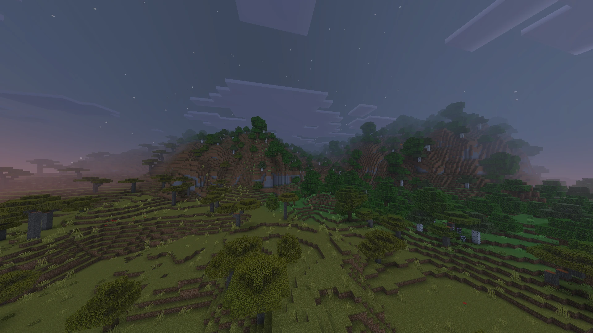
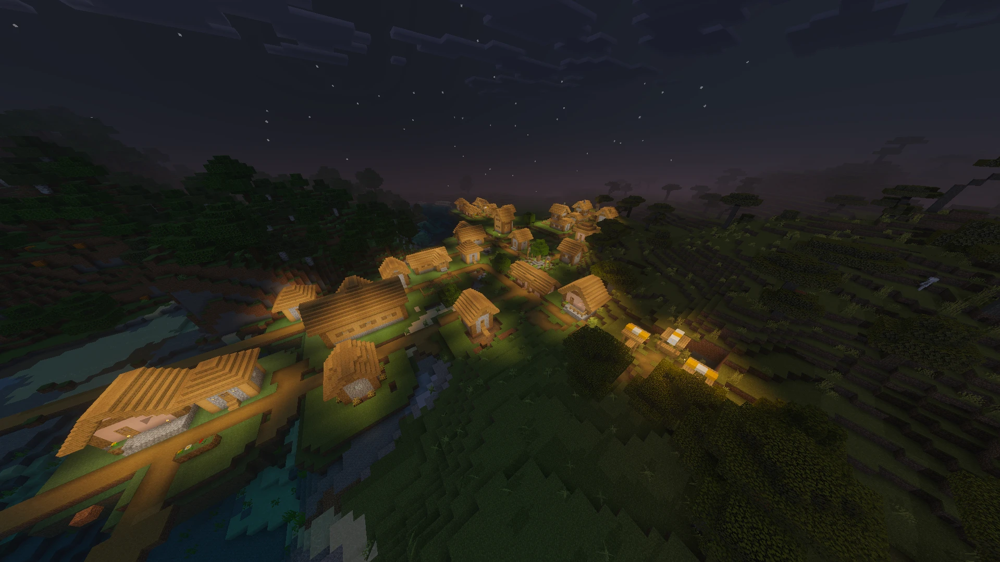
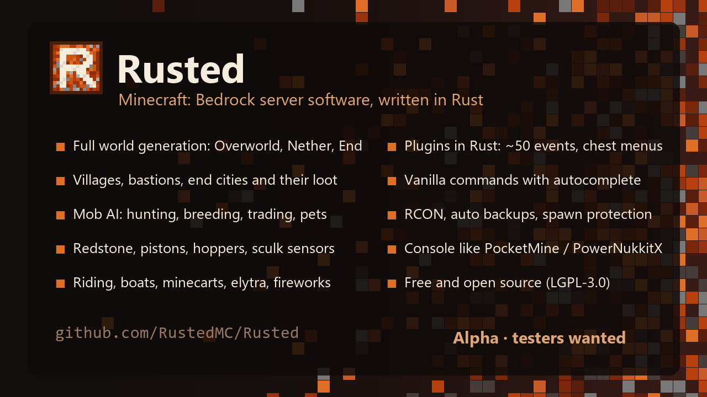

<p align="center">
  
</p>

<p align="center">
  <a href="https://github.com/RustedMC/Rusted/actions/workflows/build.yml"></a>
  <a href="LICENSE"></a>
  
  <a href="https://discord.gg/HBegxHxREc"></a>
</p>

<p align="center">
  <a href="https://discord.gg/HBegxHxREc"></a>&nbsp;&nbsp;
  <a href="https://rustedmc.github.io/Rusted/"></a>
</p>

> NOT AN OFFICIAL MINECRAFT PRODUCT. NOT APPROVED BY OR ASSOCIATED WITH MOJANG OR MICROSOFT.
> Rusted is independent server software compatible with Minecraft: Bedrock Edition. Minecraft is a
> trademark of Microsoft Corporation.

> [!WARNING]
> Rusted is in early development. Most of survival plays like vanilla, but expect bugs and
> missing features, and back up your worlds. Don't run it for a public server you care about
> yet.

A Minecraft: Bedrock Edition server written in Rust, ported from
[PowerNukkitX](https://github.com/PowerNukkitX/PowerNukkitX). It uses PowerNukkitX's world
generator, so worlds look the same seed for seed, but it starts in under a second and needs a
tenth of the memory, so it runs happily on a cheap VPS.


| | |
| --- | --- |
|  |  |
|  |  |

*All terrain above is generated by Rusted, in game, with no mods or resource packs on the server.*

## Rusted vs PowerNukkitX

Both servers on the same Windows PC, each started from its release build, measured after 30
seconds idle with no players online:

| | Rusted 0.3 | PowerNukkitX |
| --- | --- | --- |
| **Start-up** (launch to "Done") | **0.9 s** | 10.5 s |
| **Memory at idle** | **40 MB** | 417 MB |
| **Download** | **~8 MB** zip | ~94 MB jar, plus Java |
| **Needs installed** | nothing | Java 21 |

Memory grows with players and loaded chunks on both. These numbers are for an empty server,
so treat them as a rough guide, not a promise.

## Running it

**Just want to play?** Download the server for Windows or Linux from the
[latest release](https://github.com/RustedMC/Rusted/releases/latest), unzip it and run
`start.bat` (Windows) or `./start.sh` (Linux). A console opens where you type commands like
`help`, `op <name>` and `stop`, the same as PocketMine or PowerNukkitX. Then add a server in
Minecraft with your machine's address, port `19132`.

To build it yourself, you need [Rust](https://rustup.rs) (and the Visual Studio C++ build tools on Windows).

```bash
git clone https://github.com/RustedMC/Rusted.git
cd Rusted
cargo run --release
```

Then add a server in Minecraft with your machine's address, port `19132`.

The first run creates `server.properties` (port, MOTD, seed, game mode, difficulty,
view distance, allowlist) and `identity.pem`. Don't share `identity.pem`, it's the server's
private key.

Structures like villages, mansions, end cities and bastions are built from templates in
`data/structures.nbt`, which is included. Keep the `data` folder next to the server.

## Hosting on a VPS

On a Linux server (Debian/Ubuntu shown):

```bash
sudo apt install build-essential git
curl https://sh.rustup.rs -sSf | sh
git clone https://github.com/RustedMC/Rusted.git && cd Rusted
cargo build --release

sudo useradd -r -m -d /opt/rusted rusted
sudo cp target/release/rusted /opt/rusted/ && sudo cp -r data /opt/rusted/
sudo chown -R rusted: /opt/rusted
sudo cp deploy/rusted.service /etc/systemd/system/
sudo systemctl enable --now rusted
```

Open UDP **and** TCP port `19132` in the firewall (`sudo ufw allow 19132`), and in your
provider's panel if it has one. Newer clients join over TCP, older ones over UDP.

- Logs: `journalctl -u rusted -f`
- Settings: edit `/opt/rusted/server.properties`, then `sudo systemctl restart rusted`
- Stopping saves the world and players first.

To update, pull, rebuild and copy the binary again, then restart.

At home, the same steps work on any Linux box. You'll also need to forward port 19132
(UDP and TCP) on your router so friends outside your network can join.

## What's in

Vanilla behaviour is the goal. Here's what works today:

| | |
| --- | --- |
| **World** | PowerNukkitX's Overworld, Nether and End generators, seed for seed, with villages, mineshafts, strongholds, ancient cities, fortresses, bastions, end cities and their loot |
| **Survival** | Hunger, XP, mining, crafting, enchanting, brewing, anvils, smithing, fishing, beacons, effects |
| **Combat** | Bows, crossbows, tridents, shields, totems, fireworks, knockback |
| **Redstone** | Dust, repeaters, comparators, observers, pistons, hoppers, droppers, pressure plates, sculk sensors |
| **Mobs** | 70+ kinds with real AI: hostiles hunt and search for you, animals breed, villagers work and trade, pets follow and defend you, raids, the Ender Dragon |
| **Getting around** | Horses, pigs, striders, camels, boats, minecarts, elytra, Nether and End portals |
| **For server owners** | A console like PocketMine/PNX, automatic backups, RCON, spawn protection, allowlist and bans, vanilla commands with autocomplete |
| **Lobby core** | A built-in hub plugin: server selector with live player counts, NPCs that send players to servers, sidebar, settings menu |
| **Plugins** | Written in Rust: about 50 events, custom commands, permissions, chest menus, forms, scoreboards and boss bars |

What's still missing is listed in [ROADMAP.md](ROADMAP.md).

## How it works

```text
Minecraft (any device)
        │  RakNet (UDP) or NetherNet (TCP)
bedrock-rs  ── the Bedrock protocol: packets, login, encryption
        │
Rusted      ── worlds, mobs, redstone, commands, plugins
```

Built on these libraries:

| Library | Used for |
| --- | --- |
| [bedrock-rs](https://github.com/bedrock-crustaceans/bedrock-rs) | The Bedrock protocol, RakNet and NetherNet connections, login |
| [PowerNukkitX](https://github.com/PowerNukkitX/PowerNukkitX) | The source Rusted is ported from: world generation, mobs, game rules |
| [tokio](https://tokio.rs) | Networking and the async runtime |

## Plugins

Plugins are compiled in. Implement `Plugin` and override the events you want:

```rust
pub struct SpawnGreeter;

impl Plugin for SpawnGreeter {
    fn name(&self) -> &str { "spawn-greeter" }

    fn on_join(&self, server: &Server, player: &PlayerInfo) {
        server.broadcast(&format!("{} joined the game", player.name));
    }
}
```

Then add it to `plugin::all()` in [`src/plugin.rs`](src/plugin.rs). The [plugin docs](https://rustedmc.github.io/Rusted/plugins/first-plugin.html)
cover every event, commands, the scheduler, config files and forms.

## Contributing

Issues and pull requests are welcome, see [CONTRIBUTING.md](CONTRIBUTING.md).
Questions or just want to hang out? Join the [Discord](https://discord.gg/HBegxHxREc).

## License

By Gardery, under the [LGPL-3.0](LICENSE) like PowerNukkitX. Networking uses
[bedrock-rs](https://github.com/bedrock-crustaceans/bedrock-rs). Credits in
[NOTICE.md](NOTICE.md).

Not affiliated with Mojang or Microsoft.
