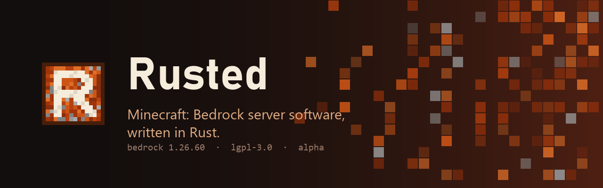

<p align="center">
  
</p>

<p align="center">
  <a href="https://github.com/RustedMC/Rusted/actions/workflows/build.yml"></a>
  <a href="LICENSE"></a>
  
  
</p>

Rusted is a Minecraft: Bedrock Edition server you run as one small program. It's a Rust
rewrite of [PowerNukkitX](https://github.com/PowerNukkitX/PowerNukkitX): same game rules, same
world generation, no Java required.

It's early (alpha), but you can already join, build, fight the dragon and trade with
villagers. Come help shape it!

## Why you might like it

**It's light.** No JVM to install or tune, no garbage-collector stutter. Download and run.

**Worlds match PNX.** Same seed, same terrain, caves, villages and fortresses.

**It uses your whole CPU.** Chunks generate in parallel, so exploring stays smooth.

**Plugins are plain Rust.** Hook an event, return `false` to cancel it, done.

## Getting started

You'll need [Rust](https://rustup.rs). On Windows, also install the Visual Studio Build
Tools with the C++ workload.

```bash
git clone https://github.com/RustedMC/Rusted.git
cd Rusted
cargo run --release
```

Open Minecraft, add a server with your computer's address and port `19132`, and join.

<details>
<summary><b>Settings</b> (server.properties)</summary>

The file is created on first launch. Restart after changing it.

```properties
server-port=19132        # RakNet (UDP) and NetherNet (TCP)
motd=Rusted              # name in the server list
max-players=35
level-type=normal        # normal | flat | void | <plugin generator>
level-seed=              # number or text, empty for random
gamemode=survival
difficulty=normal
view-distance=16         # 2-96 chunks
white-list=false
```

`identity.pem` is created next to it. Keep a backup and never share it, it's the server's
private key.
</details>

## What's in so far

| | |
|---|---|
| 🌍 **Worlds** | Overworld with every biome and structure, Nether with fortresses and bastions, End with cities and gateways, flat and void |
| ⚒️ **Survival** | Hunger, XP, enchanting, brewing, anvils, smithing, trading, raids, the dragon fight |
| 🔴 **Redstone** | Dust, repeaters, comparators, observers, pistons, dispensers, hoppers |
| 🐺 **Mobs** | 70+ types, spawning by biome and dimension |
| 🛡️ **Admin** | Vanilla commands with target selectors, scoreboards, ops, allowlist, bans |

Full progress is in [PORTING.md](PORTING.md), plans are in [ROADMAP.md](ROADMAP.md).

## Writing a plugin

```rust
pub struct SpawnGreeter;

impl Plugin for SpawnGreeter {
    fn name(&self) -> &str { "spawn-greeter" }

    fn on_join(&self, server: &Server, player: &PlayerInfo) {
        server.broadcast(&format!("{} joined the game", player.name));
    }
}
```

Register it in `plugin::all()` in [`src/plugin.rs`](src/plugin.rs). That file lists every
event, plus the scheduler, config files, forms and scoreboards.

## Get involved

Found a bug or have an idea? [Open an issue](https://github.com/RustedMC/Rusted/issues/new/choose).
Want to code? Read [CONTRIBUTING.md](CONTRIBUTING.md) and send a pull request. First-timers are
welcome.

## License

Made by **Gardery**. Licensed under the [LGPL-3.0](LICENSE), like PowerNukkitX, which Rusted is
ported from. Networking uses [bedrock-rs](https://github.com/bedrock-crustaceans/bedrock-rs).
See [NOTICE.md](NOTICE.md) for all credits.

<sub>Not affiliated with Mojang Studios or Microsoft.</sub>
