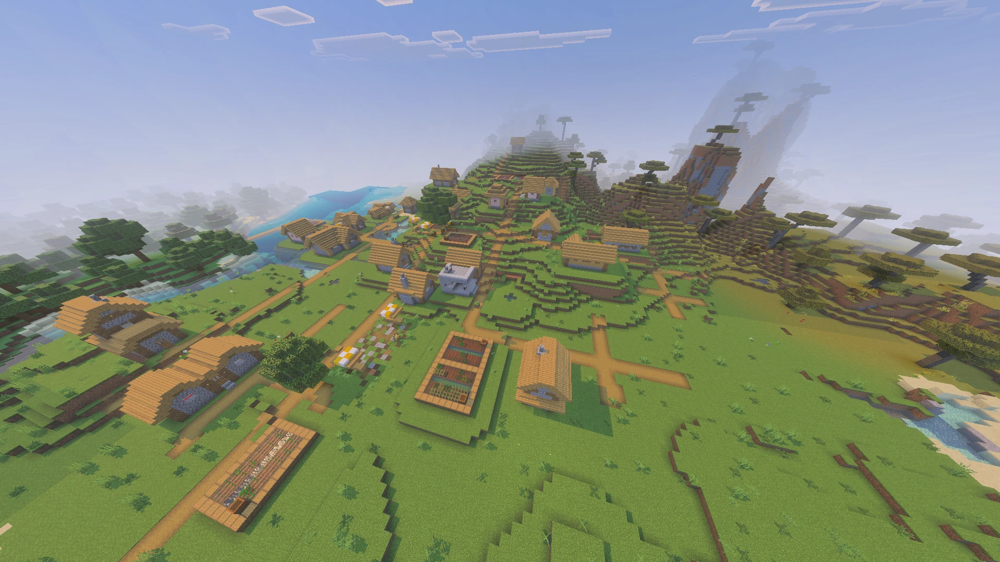
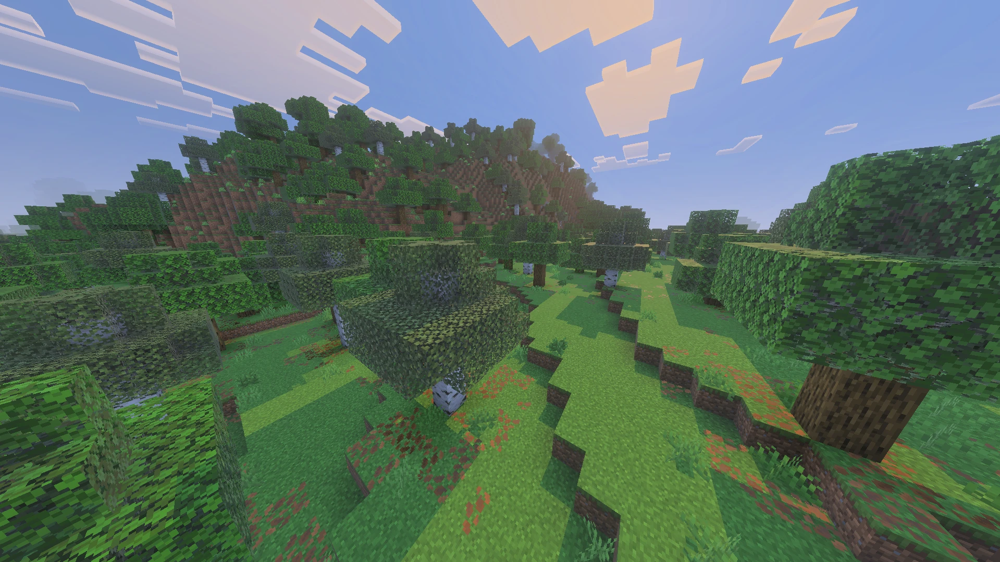

<h3 align="center">Vanilla Bedrock. Rust speed. One small download.</h3>

<p align="center">
  <a href="https://github.com/RustedMC/Rusted/releases/latest"></a>
  <a href="https://github.com/RustedMC/Rusted/actions/workflows/build.yml"></a>
  
  <a href="https://discord.gg/HBegxHxREc"></a>
</p>

<p align="center">
  <a href="https://discord.gg/HBegxHxREc"></a>&nbsp;&nbsp;
  <a href="https://rustedmc.github.io/Rusted/"></a>
</p>

```text
  ____            _           _
 |  _ \ _   _ ___| |_ ___  __| |
 | |_) | | | / __| __/ _ \/ _` |
 |  _ <| |_| \__ \ ||  __/ (_| |
 |_| \_\\__,_|___/\__\___|\__,_|

Starting Rusted 0.3.0 for Minecraft: Bedrock Edition 1.26.60
Rusted listening on 0.0.0.0:19132 (RakNet UDP + NetherNet TCP)
Level 'world': seed 1794952337106584800
Done (0.2s)! Players can join on port 19132. Type "help" for commands, "stop" to shut down.
```

**Rusted** is a Minecraft: Bedrock Edition server written in Rust, ported piece by piece from
[PowerNukkitX](https://github.com/PowerNukkitX/PowerNukkitX). Same world generator, same seeds,
same vanilla feel, but it boots in under a second and idles on about 40 MB, so a cheap VPS or an
old laptop is plenty.

> [!CAUTION]
> **Alpha software.** Survival mostly plays like vanilla, but there are bugs and missing pieces.
> Keep backups (Rusted makes them for you) and test before you open it to the public.

## The numbers

Same PC, release builds, idle for 30 seconds with nobody online:

```text
Start-up            Rusted  █ 0.9 s
                    PNX     ████████████ 10.5 s

Memory at idle      Rusted  █ 40 MB
                    PNX     ██████████ 417 MB

Download            Rusted  █ ~8 MB, nothing else to install
                    PNX     ████████████ ~94 MB jar + Java 21
```

Both use more with players and loaded chunks, so think of these as how light the base is, not
a promise for a busy server.

## In game

<p align="center">
  
  
</p>

<sub>Terrain Rusted generated, in the normal game, with no packs on the server.</sub>

## Running in 60 seconds

1. Grab the [latest release](https://github.com/RustedMC/Rusted/releases/latest) for Windows or Linux and unzip it.
2. Run `start.bat` (Windows) or `./start.sh` (Linux). A console opens; type `help`, `op <name>`, `stop`.
3. In Minecraft go to **Servers → Add Server**, enter your PC's address and port `19132`.

That's it. `server.properties` (port, MOTD, seed, game mode, view distance, backups, RCON...)
is created on the first run. Keep `identity.pem` private, it's the server's key.

<details>
<summary><b>Build it yourself</b></summary>

You need [Rust](https://rustup.rs) (and the Visual Studio C++ build tools on Windows).

```bash
git clone https://github.com/RustedMC/Rusted.git
cd Rusted
cargo run --release
```

Structure templates (villages, mansions, end cities, bastions...) live in
`data/structures.nbt`. Keep the `data` folder next to the server.

</details>

<details>
<summary><b>Host it on a VPS (Linux)</b></summary>

Debian/Ubuntu shown:

```bash
sudo apt install build-essential git
curl https://sh.rustup.rs -sSf | sh
git clone https://github.com/RustedMC/Rusted.git && cd Rusted
cargo build --release

sudo useradd -r -m -d /opt/rusted rusted
sudo cp target/release/rusted /opt/rusted/ && sudo cp -r data /opt/rusted/
sudo chown -R rusted: /opt/rusted
sudo cp deploy/rusted.service /etc/systemd/system/
sudo systemctl enable --now rusted
```

Open UDP **and** TCP port `19132` (`sudo ufw allow 19132`) and in your provider's panel.
Logs: `journalctl -u rusted -f`. Stopping saves the world first. At home, forward port 19132
(UDP and TCP) on your router so friends outside can join.

</details>

## What you get

**The world.** PowerNukkitX's Overworld, Nether and End generators, seed for seed: villages,
mineshafts with chest minecarts, strongholds, ancient cities, ruined portals, fortresses,
bastions and end cities, all with their loot.

**Survival.** Mining with proper cracks and drops, crafting, enchanting, brewing, anvils,
smithing, fishing, beacons. Bows, crossbows, tridents, shields, totems and fireworks.

**Redstone.** Dust, repeaters, comparators, observers, pistons, hoppers, droppers, pressure
plates and sculk sensors, with fences, walls, panes and stairs joining up like vanilla.

**Mobs.** 70+ kinds on a real AI: hostiles hunt and search for you, animals breed, villagers
work by day and hide at night, pets sit, follow and defend you. Raids and the Ender Dragon too.

**Getting around.** Horses, pigs, striders, camels, boats, minecarts, elytra and portals.

**Running a server.** A PocketMine-style console, automatic backups, RCON for hosting panels,
spawn protection, idle kick, allowlist and bans, and every vanilla command with autocomplete.

**Resource packs.** Drop packs into `resource_packs/` and players download them when they join.

**A lobby, built in.** Turn on the lobby core and you get a server selector with live player
counts, NPCs that send players to your other servers, a sidebar and a settings menu.

The full list of what's done and what isn't is in [ROADMAP.md](ROADMAP.md).

## Plugins, in Rust

Override only the events you need; leave the rest out.

```rust
pub struct NoGrief;

impl Plugin for NoGrief {
    fn name(&self) -> &str { "no-grief" }

    fn on_block_break(&self, server: &Server, player: &PlayerInfo, pos: (i32, i32, i32), _block: i32) -> bool {
        let at_spawn = pos.0.abs() < 50 && pos.2.abs() < 50;
        if at_spawn {
            server.tell(player.id, "§cNo building at spawn!");
        }
        !at_spawn
    }
}
```

About 50 events, custom commands, permissions, per-player config, chest menus, forms,
scoreboards and boss bars. Add your plugin to `plugin::all()` in [`src/plugin.rs`](src/plugin.rs),
and see the [plugin docs](https://rustedmc.github.io/Rusted/plugins/first-plugin.html).

## Under the hood

```text
Minecraft on any device
   │  RakNet (UDP) or NetherNet (TCP)
   ▼
bedrock-rs ─── the Bedrock protocol: packets, login, encryption
   │
   ▼
Rusted ─────── worlds, mobs, redstone, commands, plugins
```

Rusted stands on [bedrock-rs](https://github.com/bedrock-crustaceans/bedrock-rs) for the
protocol and [tokio](https://tokio.rs) for networking, and is ported from
[PowerNukkitX](https://github.com/PowerNukkitX/PowerNukkitX).

## Get involved

Found a bug or have an idea? Open an issue, or come say hi on the
[Discord](https://discord.gg/HBegxHxREc). Pull requests are welcome, see
[CONTRIBUTING.md](CONTRIBUTING.md).

---

<sub>By SXCULPZ and Claude, under the [LGPL-3.0](LICENSE) like PowerNukkitX. Credits in [NOTICE.md](NOTICE.md).
Rusted is independent server software and is not an official Minecraft product. It is not
approved by or associated with Mojang or Microsoft. Minecraft is a trademark of Microsoft
Corporation.</sub>
