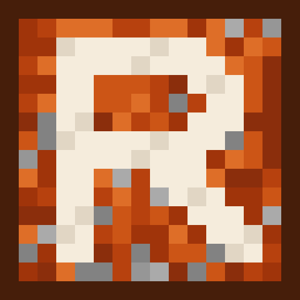

# Rusted

Rusted is a Minecraft: Bedrock Edition server written in Rust, ported from
[PowerNukkitX](https://github.com/PowerNukkitX/PowerNukkitX). It supports Bedrock **1.26.60**.

It's an alpha. You can join, survive, build redstone, go to the Nether and the End and trade
with villagers, but some features are still missing or simpler than in PNX. The
[porting status](porting.md) page lists what's done.

## Where to start

- **Running a server:** [Getting started](getting-started.md), then [Configuration](configuration.md).
- **Hosting it for friends:** [Hosting on a VPS](hosting.md).
- **Writing plugins:** [Your first plugin](plugins/first-plugin.md).

## Links

- Source code: [github.com/RustedMC/Rusted](https://github.com/RustedMC/Rusted)
- Discord: [discord.gg/HBegxHxREc](https://discord.gg/HBegxHxREc)
- Bugs and ideas: [GitHub issues](https://github.com/RustedMC/Rusted/issues)
